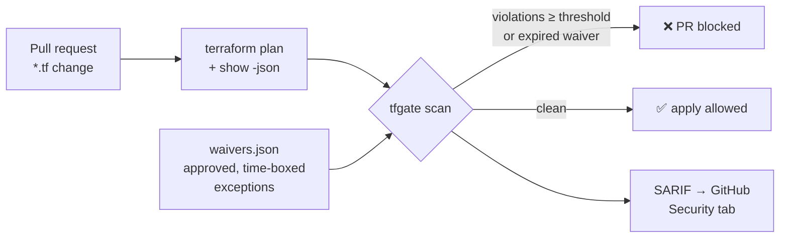

# tf-compliance-gate (`tfgate`)


A policy-as-code gate for Terraform. It reads a Terraform plan and checks every resource about to be created or changed against security rules mapped to **NIST SP 800-53** controls, the catalog FedRAMP baselines are built on. It fails the pipeline **before** a non-compliant resource is deployed.

It uses only the Python standard library, so there's nothing extra to vet in a regulated pipeline.



## Quick start

```bash
pip install -e '.[dev]'
tfgate rules                                               # list rules and their 800-53 controls
tfgate scan examples/plan.json --waivers examples/waivers.json
echo $?                                                    # 1 = gate failed
```

```text
Scanned 8 resource change(s).

SEVERITY  RULE        CONTROLS       RESOURCE                                      DETAIL
CRITICAL  AWS-S3-001  AC-3,SC-7      aws_s3_bucket_public_access_block.data        not enabled: block_public_policy, restrict_public_buckets
CRITICAL  AWS-SG-001  SC-7,AC-17     aws_security_group.bastion                    ingress allows port(s) [22] from the internet
CRITICAL  AZ-NSG-001  SC-7,AC-17     azurerm_network_security_group.web            allow-rdp allows port(s) [3389] from the internet
...
HIGH*     AZ-SQL-001  SC-8,SC-7      azurerm_mssql_server.db                       minimum_tls_version is '1.0'
...
15 finding(s), 2 waived (*), 10 at or above HIGH.
```

With a real Terraform project:

```bash
terraform plan -out plan.out
terraform show -json plan.out > plan.json
tfgate scan plan.json --fail-on high --format sarif -o tfgate.sarif
```

## Rules

| Rule | Severity | NIST 800-53 | Checks |
|---|---|---|---|
| AZ-STG-001 | High | SC-8, SC-13 | Storage account requires TLS 1.2+ |
| AZ-STG-002 | High | SC-8 | Storage account is HTTPS-only |
| AZ-STG-003 | Critical | AC-3, SC-7 | No public network access or public blobs |
| AZ-KV-001 | High | SC-12, CP-9 | Key Vault purge protection and soft delete |
| AZ-KV-002 | Medium | AC-3, AC-6 | Key Vault uses RBAC and blocks public access |
| AZ-NSG-001 | Critical | SC-7, AC-17 | No SSH/RDP open to the internet (NSGs and NSG rules) |
| AZ-SQL-001 | High | SC-8, SC-7 | SQL server TLS 1.2+ and no public access |
| AZ-AKS-001 | High | AC-2, IA-2 | AKS uses Entra ID RBAC with local accounts disabled |
| AWS-S3-001 | Critical | AC-3, SC-7 | S3 public access block fully enabled |
| AWS-SG-001 | Critical | SC-7, AC-17 | No SSH/RDP open to the internet (security groups) |
| TAG-001 | Low | CM-8, RA-2 | `owner`, `environment`, `data_classification` tags present |

Adding a rule takes a decorated function plus a test (see `src/tfgate/rules.py`).

## Waivers: exceptions with an expiry date

Real programs have exceptions. FedRAMP tracks them as POA&M items. A waiver must say which rule, which resource, why, who approved it and when it expires:

```json
{"waivers": [{
  "rule_id": "AZ-SQL-001",
  "address": "azurerm_mssql_server.db",
  "reason": "Legacy client needs TLS 1.0 until migration; tracked in POAM-042",
  "approved_by": "isso@example.com",
  "expires": "2026-12-31"
}]}
```

A waiver with a missing field is rejected, and **an expired waiver fails the gate**. An exception can't quietly become permanent.

## Outputs and exit codes

- `--format table` (default), `json` (for other tools) or `sarif` (GitHub code scanning; waived findings show as suppressed)
- `--fail-on low|medium|high|critical` sets the lowest severity that fails the gate (default `high`)
- Exit `0` means it passed, `1` means violations or expired waivers, `2` means bad input (not a plan, unreadable file, malformed waiver)

`examples/terraform-pipeline.yml` is a ready-to-use GitHub Actions workflow for a Terraform repository. It logs in to Azure with OIDC (no stored secret), runs the plan, runs the gate and uploads SARIF.

## Tests

```bash
pytest --cov=tfgate      # 27 tests, ~97% coverage
```

Tests cover the security behavior, not just the happy path. They include port ranges that contain 22, `*` wildcards, IPv6 `::/0`, "all protocols" rules, deny rules and outbound rules that must *not* be flagged, unset attributes treated as non-compliant, deleted resources skipped, and expired waivers failing the gate.

## Why a plan scanner (and not only Azure Policy)?

Azure Policy enforces rules at deploy time, inside Azure. `tfgate` gives feedback **earlier**, on the pull request, with the exact resource address and fix. It also covers AWS in the same tool. The two are complementary: shift left with `tfgate`, and keep Azure Policy `deny` as the backstop.
